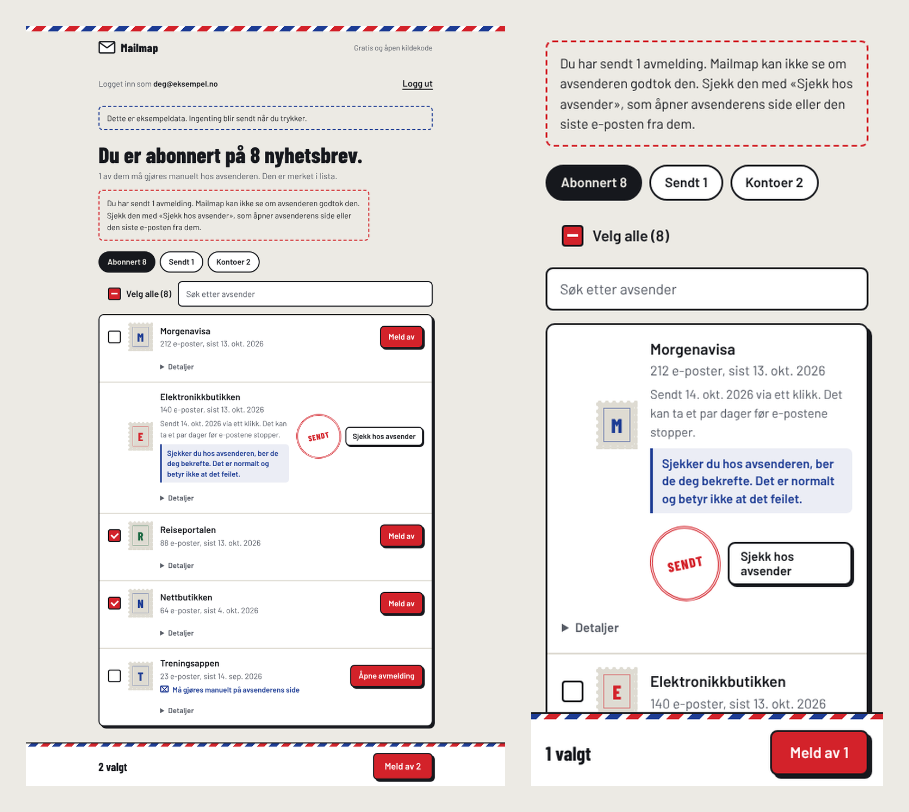

# mailmap

**Alle nyhetsbrevene dine, samlet på ett sted.** Logg inn med e-postkontoen din, og Mailmap lister opp alt du er
abonnert på. Mange kan du melde deg av direkte herfra. Noen krever at du bekrefter på avsenderens egen side.

*All your newsletters in one place. Sign in, see everything you're subscribed to, and unsubscribe – directly where the
sender allows it, on the sender's own page where it doesn't. No server; everything runs in your browser.*

**Prøv den:** [danishk918.github.io/Mailmap](https://danishk918.github.io/Mailmap/) – «Prøv uten å logge inn» viser en demo med eksempeldata.
[Personvernerklæring](https://danishk918.github.io/Mailmap/personvern.html)



*Demoen med eksempeldata, på PC og mobil.*

## Slik virker det

1. Brukeren logger inn med Microsoft (Outlook/Hotmail) eller Google (Gmail). Begge er åpne for alle. Google viser et
   varsel om at appen ikke er verifisert, og Gmail er begrenset til 100 brukere totalt (se Begrensninger).
   Før Google-innloggingen forklarer Mailmap hvorfor varselet kommer og hva brukeren skal trykke, med lenke til
   personvernerklæringen og koden.
2. Siden leser **kun headerne** (`From`, `Subject`, `Date`, `List-Unsubscribe`) i de nyeste e-postene.
3. Avsendere grupperes per tjeneste. Alt med avmeldingslenke vises som abonnement, sortert etter hvem som sender mest.
4. Brukeren trykker **Meld av** på én avsender, eller huker av flere (eller **Velg alle**) og melder av samtidig.
   Et **søkefelt** filtrerer lista. Mailmap bruker alle automatiske veier avsenderen tilbyr:
   - **Ett klikk (RFC 8058):** siden sender en `POST` til avsenderens avmeldingsadresse.
   - **Via e-post:** siden sender avmeldings-e-posten fra brukerens egen konto. Dette behandles av avsenderens
     egne servere og er den mest robuste veien.
5. **Avsendere uten automatisk avmelding** er merket «Må gjøres manuelt på avsenderens side». «Åpne avmelding»
   åpner siden deres og kopierer samtidig brukerens e-postadresse, så den kan limes inn der siden spør etter den.
6. **Hver avmelding bør sjekkes.** Resultatet merkes «Sendt», ikke «Avmeldt», fordi nettleseren ikke får lese
   avsenderens svar. Mailmap sier dette rett ut etter avmelding, og hver avsender får en knapp
   **«Sjekk hos avsender»** som åpner deres side. Når du har sjekket, merkes avsenderen «Du har sjekket hos avsenderen».
   Mailmap husker også når hver avmelding ble sendt (lagret lokalt i nettleseren) og sjekker selv neste gang:
   - Ingen nye e-poster etter avmeldingen: «Ingen nye e-poster siden».
   - Nye e-poster mer enn to dager etter: «Sender fortsatt». Avsenderen legges tilbake øverst i lista, med knapp
     til avsenderens egen avmeldingsside.
7. **Detaljer** på hver avsender viser nøyaktig hvilken `List-Unsubscribe`-header og metode som brukes.
8. Kontoer uten avmelding (velkomst- og passord-e-poster) vises i en egen fane, med ferdig GDPR-slettebrev.

## Sikkerhet og personvern

| Valg | Begrunnelse |
|---|---|
| Ingen server | OAuth skjer direkte mellom nettleseren og Google/Microsoft. Tokenet ligger kun i minnet og forsvinner når fanen lukkes. |
| Minste nødvendige tilgang | Google: `gmail.metadata` (kan ikke lese innhold) + `gmail.send`. Microsoft: `Mail.Read` + `Mail.Send`. |
| PKCE uten hemmelighet | Microsoft-innloggingen bruker Authorization Code + PKCE med `state`-sjekk. Koden fjernes fra adresselinjen med en gang. |
| All e-post er fiendtlig input | Avsendernavn og emner vises kun via `textContent`. Lenker godtas kun med `https:` og `mailto:`. |
| Header-injeksjon blokkert | `mailto:`-lenker valideres (én adresse) og linjeskift fjernes fra emnet, så en avsender ikke kan smugle inn `Bcc`. |
| Forfalskning blokkert | Avsenderadressen tolkes før visningsnavnet dekodes, så et kodet navn (`=?utf-8?…?=`) ikke kan endre adressen. |
| Streng CSP | Kun egne skript + Googles innloggingsskript. Ingen `eval`, ingen inline-skript. |
| Ingen kontoenumerering | Verktøyet sjekker aldri nettsider for om e-posten er registrert. Det ser bare på e-post brukeren har mottatt. |

## Sett opp innlogging (én gang, gratis)

Du som utvikler må registrere appen hos Google og Microsoft for å få lov til å lese e-post.
Det tar ca. 15 minutter. Brukerne trenger ikke gjøre noe av dette.

**1. Publiser siden (GitHub Pages)**
Legg repoet på GitHub → *Settings* → *Pages* → *Source:* **GitHub Actions**.
Workflowen `pages.yml` publiserer `web/` til `https://danishk918.github.io/Mailmap/`.

**2. Google (Gmail)**
1. [console.cloud.google.com](https://console.cloud.google.com) → nytt prosjekt «mailmap».
2. *APIs & Services* → *Library* → aktiver **Gmail API**.
3. *Google Auth Platform* (OAuth consent screen) → *External* → fyll inn navn og e-post.
4. *Data access* → legg til `gmail.metadata` og `gmail.send`.
5. *Clients* → *Create client* → **Web application** → *Authorized JavaScript origins*:
   `https://danishk918.github.io` og `http://localhost:8000`.
6. Kopier *Client ID* inn i `web/config.js` → `googleClientId`.
7. *Branding* → *Application home page* `https://danishk918.github.io/Mailmap/`, *Privacy policy*
   `https://danishk918.github.io/Mailmap/personvern.html`, *Authorized domains* `danishk918.github.io`.
   Ikke last opp logo – det krever full verifisering.
8. *Audience* → **Publish app**. Da kan alle Google-kontoer logge inn (med varsel om uverifisert app).

**3. Microsoft (Outlook/Hotmail)**
1. [portal.azure.com](https://portal.azure.com) → *App registrations* → *New registration*.
2. *Supported account types:* **Accounts in any organizational directory and personal Microsoft accounts**.
3. *Redirect URI:* plattform **Single-page application (SPA)** →
   `https://danishk918.github.io/Mailmap/` (legg også til `http://localhost:8000/` under *Authentication*).
4. *API permissions* → *Microsoft Graph* → *Delegated* → `Mail.Read`, `Mail.Send` (`User.Read` er der fra før).
5. Kopier *Application (client) ID* inn i `web/config.js` → `microsoftClientId`.

**Test lokalt:** `cd web && python3 -m http.server 8000` → åpne `http://localhost:8000/`.
Uten oppsett fungerer **«Prøv uten å logge inn»** med eksempeldata.

**Begrensninger å kjenne til**
- Google: Appen er publisert, men ikke verifisert. Alle kan logge inn, men ser først «Google har ikke verifisert denne
  appen» (trykk *Avansert* → *Gå til …*). Uverifiserte apper er begrenset til 100 Gmail-brukere for hele appens levetid.
  Å fjerne varselet og grensen krever at Google verifiserer appen, og fordi `gmail.metadata` er et «restricted scope»,
  også en betalt sikkerhetsvurdering (CASA). Microsoft-innloggingen har ingen slik grense.
- Ved ett-klikks avmelding kan ikke nettleseren lese svaret fra avsenderen (CORS), så siden vet at forespørselen ble sendt,
  ikke at avsenderen godtok den.
- Bare de nyeste e-postene leses (`maxMessages`, standard 3000), for å holde seg innenfor Googles fartsgrenser.
- «Sendt»-status og datoer lagres bare i nettleseren der avmeldingen ble gjort. En annen enhet vet ikke om dem.
- Avsendere som bare tilbyr et skjema på egen nettside, kan ikke meldes av automatisk. Nettleseren tillater ikke
  at en side fyller ut skjemaer på en annen side.
- Hver versjon får et versjonsnummer på skriptene (`?v=<commit>`), så telefoner og hjemskjerm-ikoner henter ny kode
  etter publisering. Selve siden kan likevel være mellomlagret i opptil 10 minutter.

## Kommandolinjeversjonen

I tillegg finnes en Python-versjon for terminalen. Den kan skanne via IMAP eller fra en eksportfil (`.mbox`),
og lage en lokal HTML-rapport.

### Installer

```bash
git clone https://github.com/Danishk918/Mailmap.git
cd Mailmap
python3 -m pip install -e .          # Python 3.10+
```

### Prøv uten ekte innboks

```bash
python3 examples/make_demo.py demo.mbox
mailmap scan --file demo.mbox --open
```

### Bruk

**1. Fra eksport (tryggest, fungerer for alle)**
Gmail: [Google Takeout](https://takeout.google.com) → kun «Mail» → du får en `.mbox`-fil.

```bash
mailmap scan --file "All mail Including Spam and Trash.mbox" --exclude deg@gmail.com --open
```

**2. Direkte via IMAP (Gmail, iCloud, Yahoo m.fl.)**
Krever et *app-passord* (Gmail: totrinnsbekreftelse på → myaccount.google.com/apppasswords).

```bash
mailmap scan --imap deg@gmail.com --folder INBOX --folder "[Gmail]/All Mail" --since 2023-01-01 --open
```

**3. Outlook / Hotmail**
Microsoft godtar ikke lenger passord over IMAP for personlige kontoer, så det kreves OAuth2.
Lag en gratis app-registrering én gang:

1. [portal.azure.com](https://portal.azure.com) → *App registrations* → *New registration*
2. Kontotype: **Personal Microsoft accounts only**
3. *Authentication* → *Add a platform* → *Mobile and desktop* → huk av `nativeclient`-URI, og sett **Allow public client flows = Yes**
4. *API permissions* → *Add* → *APIs my organization uses* → **Office 365 Exchange Online** → *Delegated* → `IMAP.AccessAsUser.All`
5. Kopier *Application (client) ID*

```bash
python3 -m pip install -e ".[outlook]"
mailmap scan --imap deg@hotmail.com --client-id <CLIENT_ID> --open
```

Du får en kode du skriver inn på microsoft.com/devicelogin. Tokenet lagres i `~/.mailmap/` med filrettigheter `600`.

#### Rydde opp

- **I rapporten:** «Meld av (ett klikk)», «Åpne avmelding», eller «Kopier GDPR-sletting» for kontoer uten lenke.
- **I terminalen:**

```bash
mailmap list --category nyhetsbrev
mailmap clean --dry-run            # se hva som ville skjedd
mailmap clean                      # [a]vmeld [b]ehold [h]opp [q]uit
mailmap gdpr --address deg@hotmail.com --name "Ditt Navn"
```

## Arkitektur

```
web/
├── index.html      siden (bygges fra app.html med scripts/build_web.py)
├── app.js          innlogging, skanning, avmelding
└── config.js       dine klient-ID-er
mailmap/
├── sources.py      IMAP (passord / XOAUTH2) og .mbox/.eml → header-objekter
├── analyze.py      gruppering per domene, kategorisering, List-Unsubscribe-parsing
├── report.py       selvstendig HTML-rapport med CSP
├── unsubscribe.py  RFC 8058 one-click, mailto, GDPR-mal
└── cli.py          scan · list · clean · gdpr
```

## Tester

```bash
python3 -m pip install -e ".[dev]"
pytest -q
```

Testene dekker blant annet XSS-forsøk i avsendernavn, forfalskning via kodede navn,
ødelagte headere, at IMAP åpnes skrivebeskyttet (falsk IMAP-server) og ende-til-ende-skanning av en `.mbox`.

## Begrensninger (kommandolinje)

- Finner bare tjenester som har sendt deg e-post (og som du ikke har slettet).
- Kategoriseringen er heuristisk (nøkkelord i emnefelt).
- Sletting av kontoer må gjøres hos tjenesten selv, eller via GDPR-forespørsel.

## Lisens

MIT
