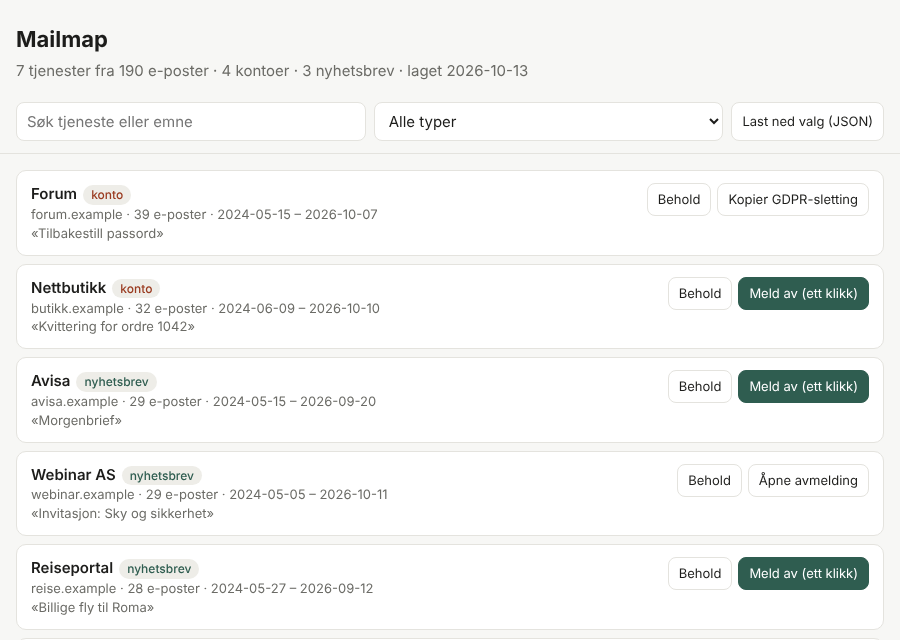

# mailmap

**Finn ut hvor e-postadressen din er registrert – og rydd opp.**
*Find every service your e-mail address is tied to, then unsubscribe or request deletion. Runs locally, reads headers only.*



mailmap skanner innboksen din, grupperer avsendere per tjeneste og sorterer dem i
**kontoer** (velkomst-, bekreftelses- og passord-e-poster), **nyhetsbrev** (har
avmeldingslenke) og **annet**. Du får en rapport der du velger *behold* eller *meld av* for hver tjeneste.

## Hvorfor det er laget slik

| Valg | Begrunnelse |
|---|---|
| Kjører lokalt, ingen server | E-posten din forlater aldri maskinen. Ingen tredjepart får tilgang. |
| Leser kun headere | `From`, `Subject`, `Date`, `List-Unsubscribe` – aldri innholdet i e-postene. |
| IMAP åpnes skrivebeskyttet | `SELECT … readonly` + `BODY.PEEK` – e-poster blir ikke markert som lest. |
| Rapporten behandler alt som fiendtlig input | Hvem som helst kan sende deg e-post, så avsendernavn og emner kan inneholde HTML/JS. Data bygges inn som escaped JSON, vises kun via `textContent`, og en streng CSP blokkerer alt annet. Lenker godtas kun med `https:` / `mailto:`. |
| Dekoder navn *etter* adresse-parsing | Hindrer at et kodet visningsnavn (`=?utf-8?q?…?=`) kan forfalske avsenderadressen. |
| Ingen automatisk «sjekk om e-posten er registrert» på nettsider | Det er kontoenumerering, bryter vilkår og er juridisk tvilsomt. mailmap ser bare på e-post du allerede har mottatt. |
| One-click etter RFC 8058, ellers manuell bekreftelse | Ekte ett-klikks avmelding sendes som POST. Vanlige lenker åpnes i nettleseren så du ser hva du bekrefter. Kun https, og redirect til http nektes. |
| Ingen avhengigheter | Kun Python standardbibliotek (`msal` er valgfritt, bare for Outlook). |

## Nettsiden (ingen installasjon)

Åpne `web/index.html` i nettleseren, eller legg den ut gratis med GitHub Pages
(Settings → Pages → mappe `/web`). Dra inn en `.mbox`- eller `.eml`-fil, så skjer
resten i nettleseren: filen leses i biter på 4 MB (fungerer med eksporter på flere GB),
bare headere tolkes, og ingenting sendes noe sted. Valgene dine huskes lokalt i nettleseren.

Nettsiden kan ikke bruke IMAP, så for direkte skanning av innboksen og automatisk
ett-klikks avmelding brukes kommandolinjeversjonen under.

## Installer

```bash
git clone https://github.com/<ditt-brukernavn>/mailmap.git
cd mailmap
python3 -m pip install -e .          # Python 3.10+
```

## Prøv uten ekte innboks

```bash
python3 examples/make_demo.py demo.mbox
mailmap scan --file demo.mbox --open
```

## Bruk

**1. Fra eksport (tryggest, fungerer for alle)**
Gmail: [Google Takeout](https://takeout.google.com) → kun «Mail» → du får en `.mbox`-fil.

```bash
mailmap scan --file "All mail Including Spam and Trash.mbox" --exclude deg@gmail.com --open
```

**2. Direkte via IMAP (Gmail, iCloud, Yahoo m.fl.)**
Krever et *app-passord* (Gmail: totrinnsbekreftelse på → myaccount.google.com/apppasswords).

```bash
mailmap scan --imap deg@gmail.com --folder INBOX --folder "[Gmail]/All Mail" --since 2023-01-01 --open
```

**3. Outlook / Hotmail**
Microsoft godtar ikke lenger passord over IMAP for personlige kontoer, så det kreves OAuth2.
Lag en gratis app-registrering én gang:

1. [portal.azure.com](https://portal.azure.com) → *App registrations* → *New registration*
2. Kontotype: **Personal Microsoft accounts only**
3. *Authentication* → *Add a platform* → *Mobile and desktop* → huk av `nativeclient`-URI, og sett **Allow public client flows = Yes**
4. *API permissions* → *Add* → *APIs my organization uses* → **Office 365 Exchange Online** → *Delegated* → `IMAP.AccessAsUser.All`
5. Kopier *Application (client) ID*

```bash
python3 -m pip install -e ".[outlook]"
mailmap scan --imap deg@hotmail.com --client-id <CLIENT_ID> --open
```

Du får en kode du skriver inn på microsoft.com/devicelogin. Tokenet lagres i `~/.mailmap/` med filrettigheter `600`.

### Rydde opp

- **I rapporten:** «Meld av (ett klikk)», «Åpne avmelding», eller «Kopier GDPR-sletting» for kontoer uten lenke.
- **I terminalen:**

```bash
mailmap list --category nyhetsbrev
mailmap clean --dry-run            # se hva som ville skjedd
mailmap clean                      # [a]vmeld [b]ehold [h]opp [q]uit
mailmap gdpr --address deg@hotmail.com --name "Ditt Navn"
```

## Arkitektur

```
mailmap/
├── sources.py      IMAP (passord / XOAUTH2) og .mbox/.eml → header-objekter
├── analyze.py      gruppering per domene, kategorisering, List-Unsubscribe-parsing
├── report.py       selvstendig HTML-rapport med CSP
├── unsubscribe.py  RFC 8058 one-click, mailto, GDPR-mal
└── cli.py          scan · list · clean · gdpr
```

## Tester

```bash
python3 -m pip install -e ".[dev]"
pytest -q
```

Testene dekker blant annet XSS-forsøk i avsendernavn, forfalskning via kodede navn,
ødelagte headere, at IMAP åpnes skrivebeskyttet (falsk IMAP-server) og ende-til-ende-skanning av en `.mbox`.

## Begrensninger

- Finner bare tjenester som har sendt deg e-post (og som du ikke har slettet).
- Kategoriseringen er heuristisk (nøkkelord i emnefelt).
- Sletting av kontoer må gjøres hos tjenesten selv, eller via GDPR-forespørsel.

## Lisens

MIT
