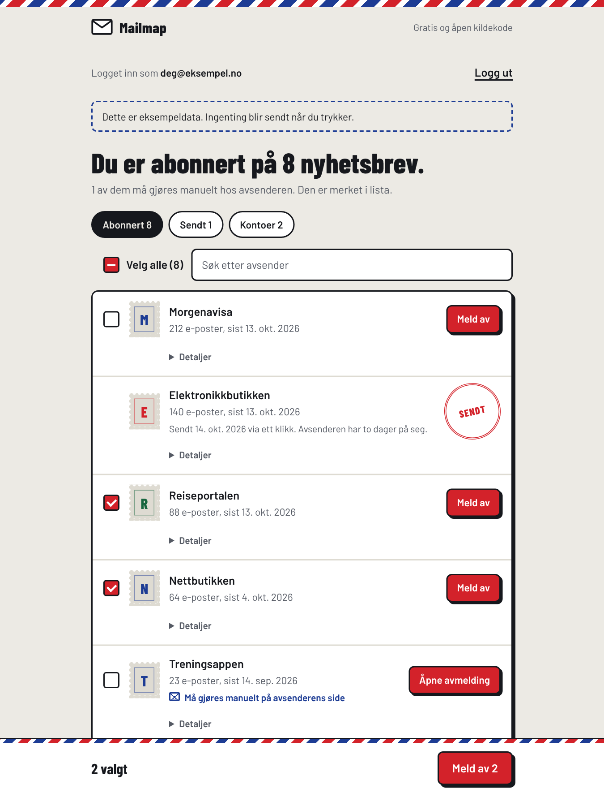

# Mailmap

**Alle nyhetsbrevene dine, samlet på ett sted.** Logg inn med e-postkontoen din, og Mailmap lister opp alt du er
abonnert på. Mange kan du melde deg av direkte herfra. Noen krever at du bekrefter på avsenderens egen side.

*All your newsletters in one place. Sign in, see everything you're subscribed to, and unsubscribe – directly where the
sender allows it, on the sender's own page where it doesn't. No server; everything runs in your browser.*

**Prøv den:** [danishk918.github.io/Mailmap](https://danishk918.github.io/Mailmap/) – «Prøv uten å logge inn» viser en demo med eksempeldata.
[Personvernerklæring](https://danishk918.github.io/Mailmap/personvern.html)



*Demoen med eksempeldata.*

## Slik virker det

1. **Logg inn** med Microsoft (Outlook/Hotmail) eller Google (Gmail). Før Google-innloggingen forklarer siden
   Googles varsel om uverifisert app, og hva du skal trykke.
2. **Mailmap leser bare e-posthodene** (`From`, `Subject`, `Date`, `List-Unsubscribe`) i de nyeste e-postene,
   aldri innholdet, og grupperer avsenderne per tjeneste. I Gmail leses kategoriene *Kampanjer* og *Oppdateringer*
   først, der nyhetsbrevene ligger, og lista vises mens resten leses.
3. **Du får én liste** over alt du er abonnert på, sortert etter hvem som sender mest, med søk og «Velg alle».
4. **Meld av** én eller mange. Mailmap bruker alle automatiske veier avsenderen tilbyr: ett-klikks avmelding
   (RFC 8058, en `POST`) og avmeldings-e-post fra din egen konto. Avsendere uten slike merkes
   «Må gjøres manuelt». Da åpnes avsenderens side, og e-postadressen din kopieres så du kan lime den inn.
5. **Sjekk resultatet.** Nettleseren får ikke lese avsenderens svar, så Mailmap skriver «Sendt», ikke «Avmeldt»,
   og gir hver avsender en «Sjekk hos avsender»-knapp. Neste gang du åpner Mailmap, merkes avsendere som fortsatt
   sender etter to dager med «Sender fortsatt» og legges øverst.
6. **Kontoer** (velkomst- og passord-e-poster uten avmelding) vises i en egen fane med ferdig GDPR-slettebrev.

## Sikkerhet og personvern

| Valg | Begrunnelse |
|---|---|
| Ingen server | OAuth skjer direkte mellom nettleseren og Google/Microsoft. Tokenet ligger kun i minnet og forsvinner når fanen lukkes. |
| Minste nødvendige tilgang | Google: `gmail.metadata` (kan ikke lese innhold) + `gmail.send`. Microsoft: `Mail.Read` + `Mail.Send`. |
| PKCE uten hemmelighet | Microsoft-innloggingen bruker Authorization Code + PKCE med `state`-sjekk. Koden fjernes fra adresselinjen med en gang. |
| All e-post er fiendtlig input | Avsendernavn og emner vises kun via `textContent`. Lenker godtas kun med `https:` og `mailto:`. |
| Header-injeksjon blokkert | `mailto:`-lenker valideres (én adresse) og linjeskift fjernes fra emnet, så en avsender ikke kan smugle inn `Bcc`. |
| Forfalskning blokkert | Avsenderadressen tolkes før visningsnavnet dekodes, så et kodet navn (`=?utf-8?…?=`) ikke kan endre adressen. |
| Streng CSP | Kun egne skript + Googles innloggingsskript. Ingen `eval`, ingen inline-skript. |
| Bare kjente e-postlenker | «Åpne siste e-post» godtar bare lenker til Gmail (bygget av Mailmap) og Outlooks egne domener, aldri en lenke fra avsenderen. |
| Ingen kontoenumerering | Verktøyet sjekker aldri nettsider for om e-posten er registrert. Det ser bare på e-post brukeren har mottatt. |

## Tester

To sett med tester kjører automatisk på GitHub ved hver endring:

- **Nettsiden** (`tests/web`, 21 tester): siden kjøres i en ekte nettleser (Chromium) mot falske Google- og
  Microsoft-tjenester, så det trengs ingen kontoer eller nett. Dekker innlogging (PKCE og Google), lesing kun av headere,
  avmelding (RFC 8058 `POST` og e-post), «Velg alle» og søk med 60 avsendere, Googles fartsgrense (ny forsøk, tidlig liste, delvise resultater), oppfølging («Sender fortsatt»),
  og sikkerhet: XSS i avsendernavn og emne, `javascript:`-lenker, header-injeksjon i `mailto:`, forfalskede
  avsendernavn, at bare Outlook/Gmail-lenker godtas, og at den strenge CSP-en ikke blokkerer noe siden trenger.
- **[Kommandolinjeversjonen](docs/KOMMANDOLINJE.md)** (`tests/test_mailmap.py`, 18 tester), på Python 3.10, 3.12 og 3.13.

```bash
python3 -m pip install -e ".[web]"
python3 -m playwright install chromium
pytest -q
```

## Begrensninger

- Google: Appen er publisert, men ikke verifisert. Alle kan logge inn, men ser først «Google har ikke verifisert denne
  appen» (trykk *Avansert* → *Gå til …*). Uverifiserte apper er begrenset til 100 Gmail-brukere for hele appens levetid.
  Å fjerne varselet og grensen krever at Google verifiserer appen, og fordi `gmail.metadata` er et «restricted scope»,
  også en betalt sikkerhetsvurdering (CASA). Microsoft-innloggingen har ingen slik grense.
- Ved ett-klikks avmelding kan ikke nettleseren lese svaret fra avsenderen (CORS), så siden vet at forespørselen ble sendt,
  ikke at avsenderen godtok den.
- Gmail tillater 6 000 «quota units» per bruker per minutt, og hver e-post koster 20. Det er rundt 300 e-poster i
  minuttet. Mailmap holder seg under grensen, leser opptil 1 000 Gmail-e-poster (3 000 i Outlook), viser lista etter
  et halvt minutt og fyller på underveis. Nås grensen likevel, prøver Mailmap igjen med økende ventetid
  (exponential backoff), og stopper Google lesingen helt, vises det som rakk å bli lest.
- «Sendt»-status og datoer lagres bare i nettleseren der avmeldingen ble gjort, og bare under e-postadressen som
  var logget inn. En annen enhet vet ikke om dem, og en annen konto i samme nettleser ser dem aldri.
- Åpner du en ett-klikks-lenke i nettleseren, kan avsenderen be deg bekrefte (pause, skriv e-post, bekreft). Det er
  med vilje: bare `POST`-en Mailmap sender melder av direkte, så lenkeskannere ikke melder folk av ved uhell. Noen
  slike lenker tar bare imot `POST` og viser en feilside; da finnes «Åpne siste e-post» under *Detaljer*.
- Avsendere som bare tilbyr et skjema på egen nettside, kan ikke meldes av automatisk. Nettleseren tillater ikke
  at en side fyller ut skjemaer på en annen side.

## Teknisk

- **Ingen rammeverk og ingen byggesteg:** ren HTML, CSS og JavaScript i `web/`, publisert med GitHub Pages.
- **Innlogging:** Google Identity Services og Microsoft (OAuth 2.0 Authorization Code + PKCE), direkte fra nettleseren.
- **API-er:** Gmail API (kun `format=metadata`) og Microsoft Graph (`internetMessageHeaders`).
- **Deling:** Open Graph-tagger og eget delingsbilde (`web/og.png`), så lenken vises som et kort på LinkedIn.

```
web/
├── app.html      siden (index.html bygges fra denne med scripts/build_web.py)
├── app.js        innlogging, skanning, avmelding
├── config.js     klient-ID-er (offentlige, ingen hemmeligheter)
└── personvern.html
tests/web/        nettlesertester mot falske Google/Microsoft-tjenester
```

- [Sett opp innlogging selv](docs/OPPSETT.md): Google Cloud, Azure og GitHub Pages, trinn for trinn.
- [Kommandolinjeversjonen](docs/KOMMANDOLINJE.md): Python-versjon som skanner via IMAP eller en `.mbox`-eksport.

## Lisens

MIT
